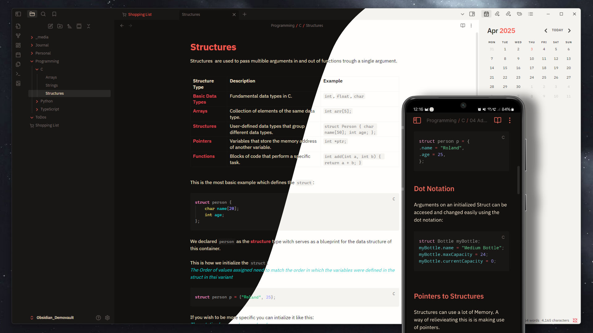

# Planetary Theme

A sleek, dual-mode Obsidian theme designed with an emphasis on warmth, vibrancy, and seamless compatibility with user-defined accent colors.

## Features

- **Dark & Light Mode** — fully polished palettes for both environments, with carefully balanced contrast and warmth.
- **Vibrant Callouts** — rich, legible callout colors even in light mode, with strong contrast between title and background.
- **Rainbow Headers** — opt-in feature that paints every heading level in a different accent color from the theme palette (red → orange → green → cyan → blue → purple).
- **Primary Font Switch** — choose between **IBM Plex Sans** (default) and **IBM Plex Serif** via the [Style Settings](https://github.com/mgmeyers/obsidian-style-settings) plugin.
- **AMOLED-Friendly Dark Mode** — deep, cozy blacks that are easy on the eyes.
- **Custom Accent Color Support** — the theme harmonizes beautifully with your personal accent color settings in Obsidian.

## Style Settings Options

Install the **Style Settings** community plugin to unlock customization options:

### Body Font
Switch the editor body font between:
- **Sans Serif** (default) — `IBM Plex Sans`
- **Serif** — `IBM Plex Serif`

### Rainbow Header Colors
Toggle on to replace the default accent-based headings with vibrant palette colors:

| Heading | Color |
|---|---|
| H1 `#` | 🔴 Red |
| H2 `##` | 🟠 Orange |
| H3 `###` | 🟢 Green |
| H4 `####` | 🔵 Cyan |
| H5 `#####` | 🔹 Blue |
| H6 `######` | 🟣 Purple |

## Note

Please note, the theme may not be 100% tested. If you encounter any errors, feel free to contact me!
